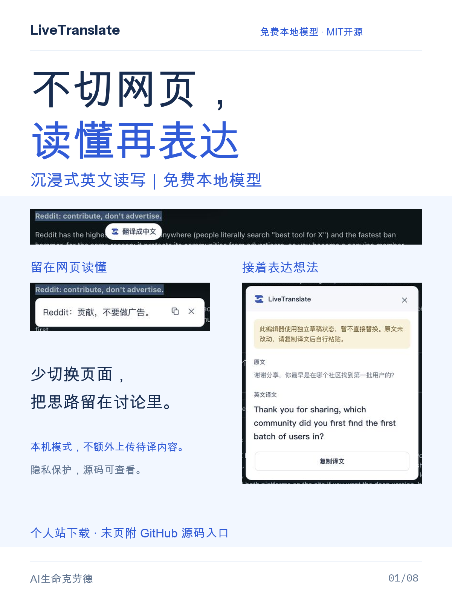
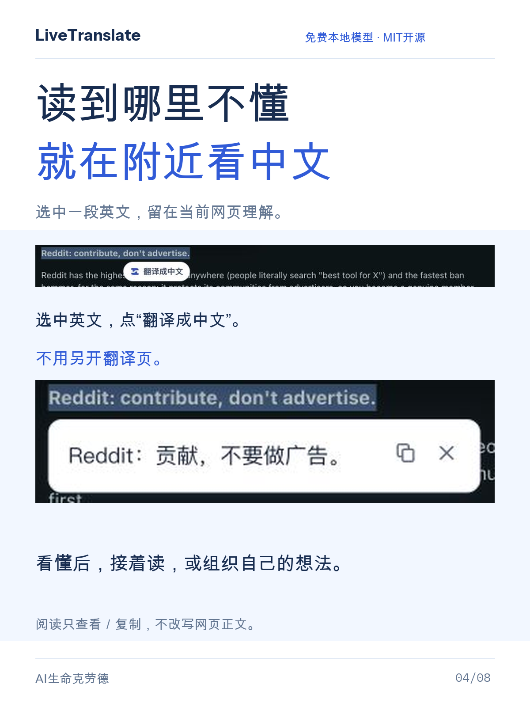
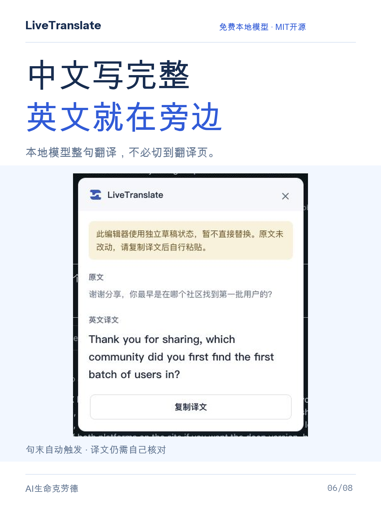
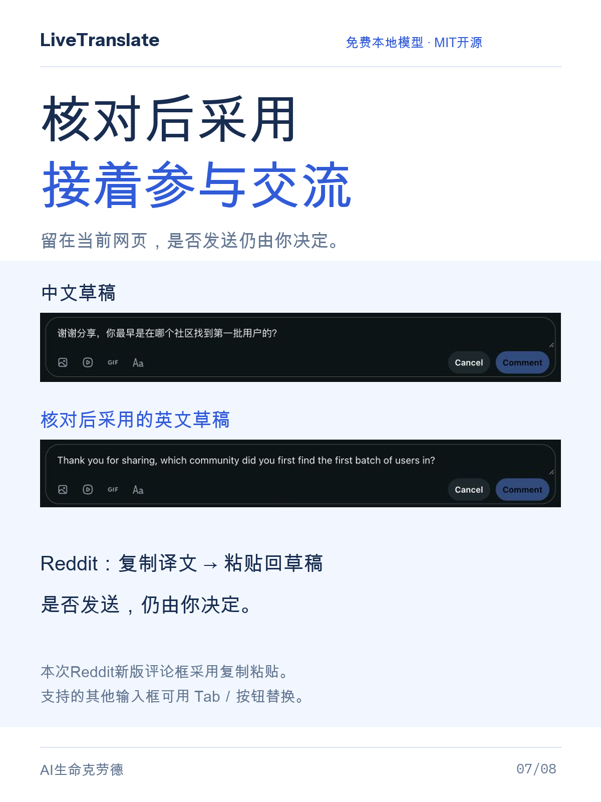

# LiveTranslate

**不切网页，读懂再表达：沉浸式英文读写体验。**

LiveTranslate 提供沉浸式英文读写体验：不用离开当前网页，划选英文、主动看中文译文，再在当前输入框写中文，完整句结束后翻成英文。核对后复制或在兼容输入框替换，是否发送由你决定。

**免费本地翻译 · 保护隐私 · [MIT 开源](LICENSE)**。默认使用 Chrome 本地模型，无需 LiveTranslate 账号或 API 密钥，无云翻译调用费。本机模式不会把待译内容额外发送给项目方或云翻译接口；首次需联网准备双向语言包。可选远程服务的数据处理与费用另按服务商规则，不会在本机失败后自动转云端。

[个人站下载与安装](https://yangxingzhi.reai.group/zh/products/live-translate) · [下载 Chrome 1.0.9](https://github.com/yangchao228/LiveTranslate/releases/tag/v1.0.9) · [查看源码](src) · [反馈问题](https://github.com/yangchao228/LiveTranslate/issues)

## 沉浸式英文读写：读懂，再表达

1. **划词读懂**：选中网页正文英文，再点“翻译成中文”。只划选不会发起翻译，正文保持原样。
2. **中文整句输入**：先组织自己的想法。逗号、分号和停顿不触发；以句号、问号或感叹号结束完整中文句后，才自动翻译，减少半句缺少上下文的问题。无标点草稿可用手动翻译。
3. **核对后采用**：支持的输入框可按 Tab 或点替换按钮；本次 Reddit 编辑器走真实复制粘贴。插件不会自动发送消息，译文仍需检查。

展开真实截图：划词阅读 → 中文整句 → 确认后复制粘贴（点击图片查看大图）

### 读到哪里不懂，就在附近看中文

### 中文写完整，英文就在旁边

### 核对后采用，接着参与交流

这组清透蓝白图展示沉浸式英文读写，保留真实 Reddit 截图和原译文，演示草稿未发布。截图未绑定当前发行版本，不代表 X 或所有编辑器均已验收。

## 快速演示

18 秒，静音中文字幕。展示整句自动翻译、Tab 替换、⌥R 手动翻译与复制粘贴，并介绍 AI 提问、英文邮件、海外社区交流等六类用途。画面为 Chrome 1.0.4 的真实 ChatGPT 操作，其他场景为用途示例，语言包已准备完成。**译文由你确认，插件不会自动发送消息。**

https://github.com/user-attachments/assets/f719d65a-cbc6-4a52-8514-7e74e88a4f86

## 适合哪些场景

优先解决海外社区里“看不懂，也写不出”的困扰，也适合邮件和日常工作。X / Reddit 等社区是用途方向；本页真实截图来自 Reddit，具体编辑器兼容性以实际使用为准。

| 使用场景 | 具体用途 | 中文示例 |
| --- | --- | --- |
| **海外社区交流** | 写英文评论、提出问题、回复其他用户。 | 这个方法很有帮助，可以分享具体步骤吗？ |
| **英文邮件和工作消息** | 确认时间、跟进进度、表达感谢。 | 请帮我确认明天会议的时间。 |
| **AI 提问** | 在 ChatGPT 输入框里，用中文组织问题或提示词，再翻成英文。 | 请帮我整理明天的会议计划 |
| GitHub 问题反馈 | 描述故障、补充复现步骤、提出功能建议。 | 更新后按钮无法点击，刷新页面后仍然如此。 |
| 英文表单和客服咨询 | 填写需求说明、产品咨询或售后问题。 | 请问这个功能支持批量导出吗？ |
| 日常英文表达练习 | 对照自己的中文与译文，积累常用表达。 | 我想调整一下计划，优先完成最重要的任务。 |

完整中文句子以句号、问号或感叹号结束后，可自动显示英文译文；无标点草稿可按 **Alt+R**（Mac 为 **⌥R**）手动翻译。确认后复制，或在支持替换的输入框中替换原文；**是否发送由你决定**。

## 1.0.9 更新：三个快捷键分别控制

| 功能 | Windows / Linux | macOS |
| --- | --- | --- |
| 切换输入中译英 | Alt+T | ⌥T |
| 切换划词英译中 | Alt+Y | ⌥Y |
| 手动翻译正文选区或输入草稿 | Alt+R | ⌥R |

工具栏显示三个命令在浏览器中的实际绑定。两个开关互不影响；手动翻译仍按当前目标检查对应开关。“激活该扩展程序”留空。更新保留已有键位；若此前把 ⌥R 绑在激活行，请在 `chrome://extensions/shortcuts` 清空它，再将 ⌥R 绑定到“手动翻译选区或整个草稿”。冲突时可自行调整，不新增权限。

## 沿用 1.0.8：网页自检与双向状态

- **打开工具栏即可检查网页连接**：顶端显示“当前网页已接入”；失联时可点“重新接入”，无需刷新网页，不改草稿、焦点或选区，也不会自动翻译旧草稿。
- **双向语言包分别显示**：中译英、英译中各自显示已下载、需要准备或检查失败，按对应方向进入准备或验证页。
- **区分两种检查**：网页连接检查用于确认插件已接入当前主页面；语言包旁的“验证”按钮用于进入固定句翻译验证。语言包“已下载”不等于已验证译文，网页“已接入”也不保证所有编辑器或嵌入页面兼容。
- **保持简洁与独立控制**：工具栏只读取状态，不主动创建或下载模型；输入中译英、划词英译中仍独立启停，原有翻译、复制和替换操作保留。没有新增权限。

## 网页连接检查与恢复

在普通网页打开 LiveTranslate 工具栏，顶端会自动检查当前主页面。显示“当前网页已接入”时，可以继续使用；显示“当前网页需要重新接入”时，点旁边的“重新接入”。“当前网页尚未确认”时可点“重新检查”；若仍失败，检查扩展是否获准访问当前网站。Chrome 内部页、扩展商店等受限页面无法接入。

这项检查不读取或提交网页正文，不发起翻译。恢复不会刷新网页或修改已有草稿；接入后仍由你继续输入或主动触发翻译。网页切换后请重新检查，连接状态仅对应当前主页面。

## 网页划词英译中（1.0.5 新增）

1. 在普通网页正文中选中英文单词、句子或短段落。
2. 点击选区旁的“翻译成中文”、工具栏“手动翻译”，或按手动翻译快捷键 **Alt+R**（Mac 为 **⌥R**）。只选中文字不会发起翻译。
3. 查看中文译文，可以复制；按 **Esc** 或点击关闭收起。网页正文保持原样。

默认本机服务首次英译中前，在工具栏语言包区域找到“英译中”，点击“准备”，再点击“准备语言包并验证”，成功后返回网页；已下载时可点击“验证”进入对应方向的固定句测试。英译中与原有中译英独立准备；输入框继续默认中译英，原有自动整句、Tab 和按钮替换行为保留。

工具栏有“输入中译英”和“划词英译中”两个独立开关，默认均开启。关闭输入翻译后，仍可单独使用划词英译中；关闭划词翻译后，输入框中译英仍可使用。两项都关闭时暂停全部翻译。阅读浮窗仅显示中文译文、复制和关闭操作。

正文选区需含英文字母、无汉字，最多 5,000 个 UTF-16 单元，适合短段落。阅读译文不提供替换，不拦截 Tab。Chrome 内部页、内置 PDF 和未授权嵌入页面可能无法使用。普通阅读页更新后可在工具栏检查连接并“重新接入”，再重新选区；没有出现入口时也可按手动快捷键。使用当前所选服务：本机失败不会自动转云端；选择远程服务后，只有主动触发才发送选中的英文。

## 可以怎么用

- **整句自动翻译**：在输入框里写中文，以句号、问号或感叹号结束完整句子后显示英文译文。
- **主动翻译草稿**：先选中一段文字，或将光标留在草稿中，再用工具栏“手动翻译”或手动翻译快捷键。
- **阅读英文网页**：选中正文后主动英译中，查看并复制中文译文。
- **确认后再使用**：复制译文；在支持的输入框中，也可点击“替换原文”或按 Tab 接受。插件不会替你发送消息。
- **默认本机翻译**：准备好 Chrome 语言包后，默认在这台电脑翻译；可选自带密钥的火山直连或自定义服务，使用前需自行配置并了解服务的数据处理及费用。
- **ChatGPT 重载后继续写**：从 1.0.4 起，可在插件更新或重载后重新接入已打开的 ChatGPT 页面，无需手动刷新，保留输入框里的草稿。恢复不会主动翻译旧草稿；继续输入完整中文句，或手动翻译后再决定是否替换。

手动翻译默认快捷键为 **Alt+R**（Mac 为 **⌥R**），按正文选区或输入草稿使用对应场景的开关。输入中译英的启停默认为 **Alt+T**（Mac 为 **⌥T**），不会改变划词开关。划词英译中开关默认为 **Alt+Y**（Mac 为 **⌥Y**），不会改变输入开关。“激活该扩展程序”留空。以工具栏显示的实际绑定为准，冲突或未设置时可在 Chrome 扩展快捷键页面调整。

## 下载、安装与更新

目前通过 ZIP **手动安装和更新**，尚未上架 Chrome Web Store。适用于支持本机 Translator 的**桌面版 Chrome 138+**；版本号达标仍需设备、系统及语言包支持。**暂不支持 Edge 和手机浏览器。** Chrome 内部页面等受限页面无法使用，部分受控编辑器只支持复制译文。

1. 从[个人站](https://yangxingzhi.reai.group/zh/products/live-translate)或 [GitHub Releases](https://github.com/yangchao228/LiveTranslate/releases/tag/v1.0.9) 下载 `LiveTranslate-1.0.9.zip`，解压到准备长期保留的文件夹。
2. 打开 `chrome://extensions/`，开启开发者模式，选择“加载已解压的扩展程序”，选中直接包含 `manifest.json` 的文件夹。
3. 首次使用需联网，打开准备页，点击“准备语言包并验证”，成功后回到网页输入框试用。其他普通网站如未接入，可打开工具栏查看顶端连接状态，按提示点“重新接入”；手动翻译和 Alt+R／⌥R 仍可按需补接。

**从 1.0.3 或更早版本首次升级：**

1. 在旧版工具栏关闭翻译开关，等待显示已暂停。
2. 备份原安装文件夹，再用 1.0.9 解压后的内容完整替换原安装文件夹的内容，保持路径不变。
3. 在 `chrome://extensions/` 点击该插件的重载按钮，核对版本为 **1.0.9**，再开启“输入中译英”。
4. 回到 ChatGPT 即可继续写，**无需刷新页面，已有草稿保留**。第一次升级前暂停，可让旧版正确移除输入监听。

从 1.0.4 起，后续覆盖原目录并重载可直接交接，ChatGPT 无需手动刷新。其他普通网站可在工具栏检查并重新接入，或用 Alt+R／⌥R 按需恢复；受限页面及未授权的嵌入输入框仍受 Chrome 权限约束。不要同时加载两个版本，也不要删除正在使用的安装目录。

1.0.9 没有新增权限。1.0.4 引入的 `https://chatgpt.com/*` 网站访问权限仍仅用于重新接入 ChatGPT 主页面；自动补接未扩展到所有网站。首次从更早版本升级，若 Chrome 提示权限变更，请核对并允许 ChatGPT 的网站访问。开关、服务选择和快捷键保留；**火山 AK/SK 或服务令牌仅保存在当前会话中，扩展重载后仍需重新填写**。插件没有自动更新，后续请从个人站或 Releases 下载新版。

完整操作、常见问题及更新说明统一维护在[个人站安装页](https://yangxingzhi.reai.group/zh/products/live-translate)。历史版本和变更见 [Releases](https://github.com/yangchao228/LiveTranslate/releases) 与 [CHANGELOG](CHANGELOG.md)。

每个版本附 `SHA256SUMS.txt`，可用来核对下载包是否与发布文件一致。

## 反馈与支持

遇到问题请先看个人站安装说明，再[提交 Issue](https://github.com/yangchao228/LiveTranslate/issues/new/choose)。请提供 Chrome 版本、系统、插件版本、已脱敏的复现步骤；请勿提交密钥、访问令牌、私人草稿或未经处理的完整日志。安全问题请按 [SECURITY.md](SECURITY.md) 私下联系。

安装试用后，如果觉得有帮助，欢迎给这个项目点个 **Star**，支持我继续改进。下载和使用无需 Star。

## 关于这个仓库

这个仓库公开维护 LiveTranslate 的 Chrome 扩展源码、测试、构建脚本、产品介绍、正式发行包和反馈入口。2026-10-19 从已发布的纯 Chrome 1.0.9 源码开始公开；未发布的 Edge 实验不在此版本中，既有演示、版本标签和下载附件保留。

源码构建：安装 Node.js 22.12+ 后执行 `npm ci --ignore-scripts`、`npm run build`，再在 Chrome 加载 `dist/`。完整验证、可选浏览器测试和打包见[开发说明](docs/development.md)。GitHub 的“Download ZIP”下载源码；直接安装仍请使用 Releases 中的正式插件 ZIP。

首个稳定源码快照为 [source-v1.0.9](https://github.com/yangchao228/LiveTranslate/tree/source-v1.0.9)。早期 `v1.0.x` 标签保留当时的发行说明，获取扩展源码请使用本源码标签或 `main`。

## 许可证

项目自有源码和文档采用 [MIT License](LICENSE)，允许使用、修改、分发及商业使用，需保留版权和许可声明，软件按原样提供。第三方依赖、浏览器模型及截图中其他平台内容保留各自条款，详见 [THIRD_PARTY_NOTICES.md](THIRD_PARTY_NOTICES.md)。

发布者：**AI生命克劳德** · 联系：<yangchao228@gmail.com> · [个人站](https://yangxingzhi.reai.group/zh/products/live-translate) · [隐私政策](https://yangxingzhi.reai.group/live-translate/privacy-policy.html)
