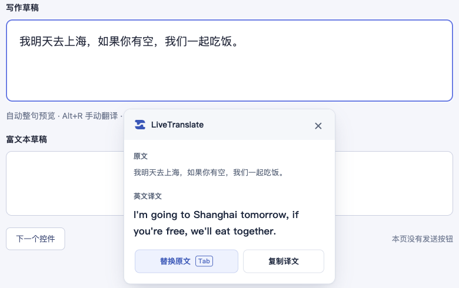

# LiveTranslate

**写作时把中文翻成英文，阅读时把选中的英文翻成中文。**

写邮件、填表单、整理英文消息时，直接写中文，查看译文后决定复制或替换。阅读英文网页时，选中一段正文，主动翻译成中文。

[下载与安装教程](https://yangxingzhi.reai.group/zh/products/live-translate) · [下载 Chrome 1.0.7](https://github.com/yangchao228/LiveTranslate/releases/tag/v1.0.7) · [反馈问题](https://github.com/yangchao228/LiveTranslate/issues)

## 快速演示

18 秒，静音中文字幕。展示整句自动翻译、Tab 替换、⌥R 手动翻译与复制粘贴，并介绍 AI 提问、英文邮件、海外社区交流等六类用途。画面为 Chrome 1.0.4 的真实 ChatGPT 操作，其他场景为用途示例，语言包已准备完成。**译文由你确认，插件不会自动发送消息。**

https://github.com/user-attachments/assets/f719d65a-cbc6-4a52-8514-7e74e88a4f86

上图为 Chrome 1.0.3 使用本机模型翻译固定示例的实际截图。译文仍需根据上下文检查。

## 适合哪些场景

先用中文组织想法，再快捷得到英文表达。

| 使用场景 | 具体用途 | 中文示例 |
| --- | --- | --- |
| **AI 提问** | 在 ChatGPT 输入框里，用中文组织问题或提示词，再翻成英文。 | 请帮我整理明天的会议计划 |
| **英文邮件和工作消息** | 确认时间、跟进进度、表达感谢。 | 请帮我确认明天会议的时间。 |
| **海外社区交流** | 写英文评论、提出问题、回复其他用户。 | 这个方法很有帮助，可以分享具体步骤吗？ |
| GitHub 问题反馈 | 描述故障、补充复现步骤、提出功能建议。 | 更新后按钮无法点击，刷新页面后仍然如此。 |
| 英文表单和客服咨询 | 填写需求说明、产品咨询或售后问题。 | 请问这个功能支持批量导出吗？ |
| 日常英文表达练习 | 对照自己的中文与译文，积累常用表达。 | 我想调整一下计划，优先完成最重要的任务。 |

完整中文句子以句号、问号或感叹号结束后，可自动显示英文译文；无标点草稿可按 **Alt+R**（Mac 为 **⌥R**）手动翻译。确认后复制，或在支持替换的输入框中替换原文；**是否发送由你决定**。

## 1.0.7 更新

- **两个开关真正独立**：第一项改名为“输入中译英”，只控制写作翻译；关闭输入翻译、单独开启“划词英译中”时，仍可选中正文英文并翻译。
- **手动翻译按目标使用对应开关**：正文选区英译中，输入草稿中译英；Alt+R（Mac 为 ⌥R）继续共用。
- **快捷启停只影响输入**：Alt+T（Mac 为 ⌥T）仅切换输入中译英，划词翻译保持自己的开关状态。
- **保留已有阅读与写作体验**：精简中文浮窗、句隙划词按钮、完整句自动中译英、复制、Tab 和按钮替换保持。

## 网页划词英译中（1.0.5 新增）

1. 在普通网页正文中选中英文单词、句子或短段落。
2. 点击选区旁的“翻译成中文”、工具栏“手动翻译”，或按手动翻译快捷键 **Alt+R**（Mac 为 **⌥R**）。只选中文字不会发起翻译。
3. 查看中文译文，可以复制；按 **Esc** 或点击关闭收起。网页正文保持原样。

默认本机服务首次英译中前，打开工具栏“准备英译中”，点击“准备语言包并验证”，成功后返回网页。英译中与原有中译英独立准备；输入框继续默认中译英，原有自动整句、Tab 和按钮替换行为保留。

工具栏有“输入中译英”和“划词英译中”两个独立开关，默认均开启。关闭输入翻译后，仍可单独使用划词英译中；关闭划词翻译后，输入框中译英仍可使用。两项都关闭时暂停全部翻译。阅读浮窗仅显示中文译文、复制和关闭操作。

正文选区需含英文字母、无汉字，最多 5,000 个 UTF-16 单元，适合短段落。阅读译文不提供替换，不拦截 Tab。Chrome 内部页、内置 PDF 和未授权嵌入页面可能无法使用。普通阅读页更新后请刷新再试；没有出现入口时也可按手动快捷键。使用当前所选服务：本机失败不会自动转云端；选择远程服务后，只有主动触发才发送选中的英文。

## 可以怎么用

- **整句自动翻译**：在输入框里写中文，以句号、问号或感叹号结束完整句子后显示英文译文。
- **主动翻译草稿**：先选中一段文字，或将光标留在草稿中，再用工具栏“手动翻译”或手动翻译快捷键。
- **阅读英文网页**：选中正文后主动英译中，查看并复制中文译文。
- **确认后再使用**：复制译文；在支持的输入框中，也可点击“替换原文”或按 Tab 接受。插件不会替你发送消息。
- **默认本机翻译**：准备好 Chrome 语言包后，默认在这台电脑翻译；可选自带密钥的火山直连或自定义服务，使用前需自行配置并了解服务的数据处理及费用。
- **ChatGPT 重载后继续写**：从 1.0.4 起，可在插件更新或重载后重新接入已打开的 ChatGPT 页面，无需手动刷新，保留输入框里的草稿。恢复不会主动翻译旧草稿；继续输入完整中文句，或手动翻译后再决定是否替换。

手动翻译默认快捷键为 **Alt+R**（Mac 为 **⌥R**），按正文选区或输入草稿使用对应场景的开关。输入中译英的启停默认为 **Alt+T**（Mac 为 **⌥T**），不会改变划词开关。以工具栏显示的实际绑定为准，冲突或未设置时可在 Chrome 扩展快捷键页面调整。

## 下载、安装与更新

目前通过 ZIP **手动安装和更新**，尚未上架 Chrome Web Store。适用于支持本机 Translator 的**桌面版 Chrome 138+**；版本号达标仍需设备、系统及语言包支持。**暂不支持 Edge 和手机浏览器。** Chrome 内部页面等受限页面无法使用，部分受控编辑器只支持复制译文。

1. 从[个人站](https://yangxingzhi.reai.group/zh/products/live-translate)或 [GitHub Releases](https://github.com/yangchao228/LiveTranslate/releases/tag/v1.0.7) 下载 `LiveTranslate-1.0.7.zip`，解压到准备长期保留的文件夹。
2. 打开 `chrome://extensions/`，开启开发者模式，选择“加载已解压的扩展程序”，选中直接包含 `manifest.json` 的文件夹。
3. 首次使用需联网，打开准备页，点击“准备语言包并验证”，成功后回到网页输入框试用。其他普通网站如未接入，可点击工具栏“手动翻译”或按 Alt+R／⌥R 补接。

**从 1.0.3 或更早版本首次升级：**

1. 在旧版工具栏关闭翻译开关，等待显示已暂停。
2. 备份原安装文件夹，再用 1.0.7 解压后的内容完整替换原安装文件夹的内容，保持路径不变。
3. 在 `chrome://extensions/` 点击该插件的重载按钮，核对版本为 **1.0.7**，再开启“输入中译英”。
4. 回到 ChatGPT 即可继续写，**无需刷新页面，已有草稿保留**。第一次升级前暂停，可让旧版正确移除输入监听。

从 1.0.4 起，后续覆盖原目录并重载可直接交接，ChatGPT 无需手动刷新。其他普通网站可用工具栏或 Alt+R／⌥R 按需恢复；受限页面及未授权的嵌入输入框仍受 Chrome 权限约束。不要同时加载两个版本，也不要删除正在使用的安装目录。

1.0.7 没有新增权限。1.0.4 引入的 `https://chatgpt.com/*` 网站访问权限仍仅用于重新接入 ChatGPT 主页面；自动补接未扩展到所有网站。首次从更早版本升级，若 Chrome 提示权限变更，请核对并允许 ChatGPT 的网站访问。开关、服务选择和快捷键保留；**火山 AK/SK 或服务令牌仅保存在当前会话中，扩展重载后仍需重新填写**。插件没有自动更新，后续请从个人站或 Releases 下载新版。

完整操作、常见问题及更新说明统一维护在[个人站安装页](https://yangxingzhi.reai.group/zh/products/live-translate)。历史版本和变更见 [Releases](https://github.com/yangchao228/LiveTranslate/releases) 与 [CHANGELOG](CHANGELOG.md)。

每个版本附 `SHA256SUMS.txt`，可用来核对下载包是否与发布文件一致。

## 反馈与支持

遇到问题请先看个人站安装说明，再[提交 Issue](https://github.com/yangchao228/LiveTranslate/issues/new/choose)。请提供 Chrome 版本、系统、插件版本、已脱敏的复现步骤；请勿提交密钥、访问令牌、私人草稿或未经处理的完整日志。安全问题请按 [SECURITY.md](SECURITY.md) 私下联系。

安装试用后，如果觉得有帮助，欢迎给这个项目点个 **Star**，支持我继续改进。下载和使用无需 Star。

## 关于这个仓库

这个仓库公开维护 LiveTranslate 的产品介绍、正式发行包和反馈入口。**开发源码目前未公开，本仓库未提供开源许可证。** 安装包通过 Releases 附件提供，不包含在仓库源码下载 ZIP 中。

发布者：**AI生命克劳德** · 联系：<yangchao228@gmail.com> · [个人站](https://yangxingzhi.reai.group/zh/products/live-translate) · [隐私政策](https://yangxingzhi.reai.group/live-translate/privacy-policy.html)
